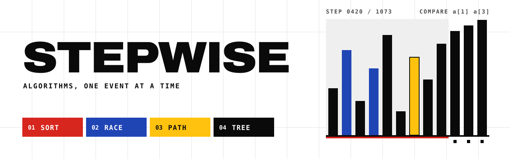
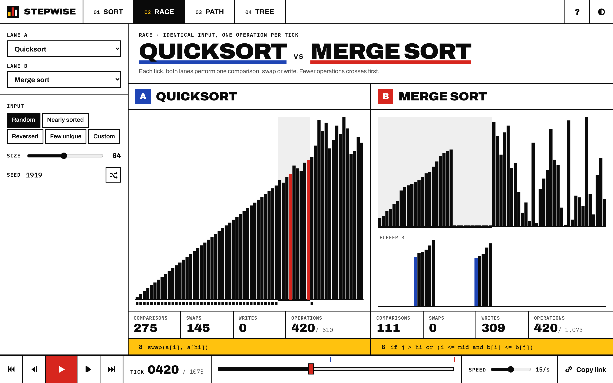
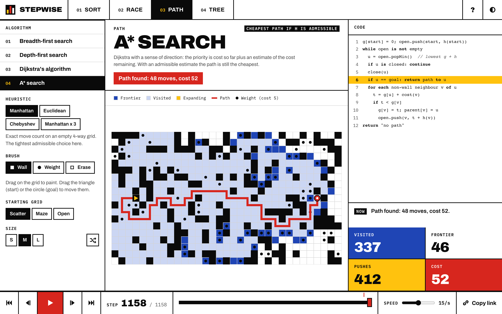
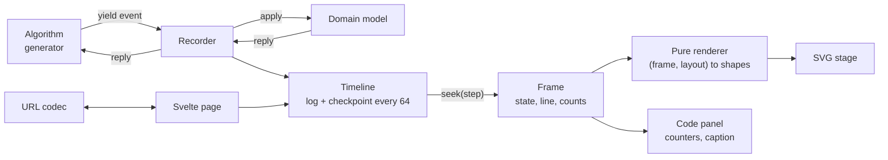
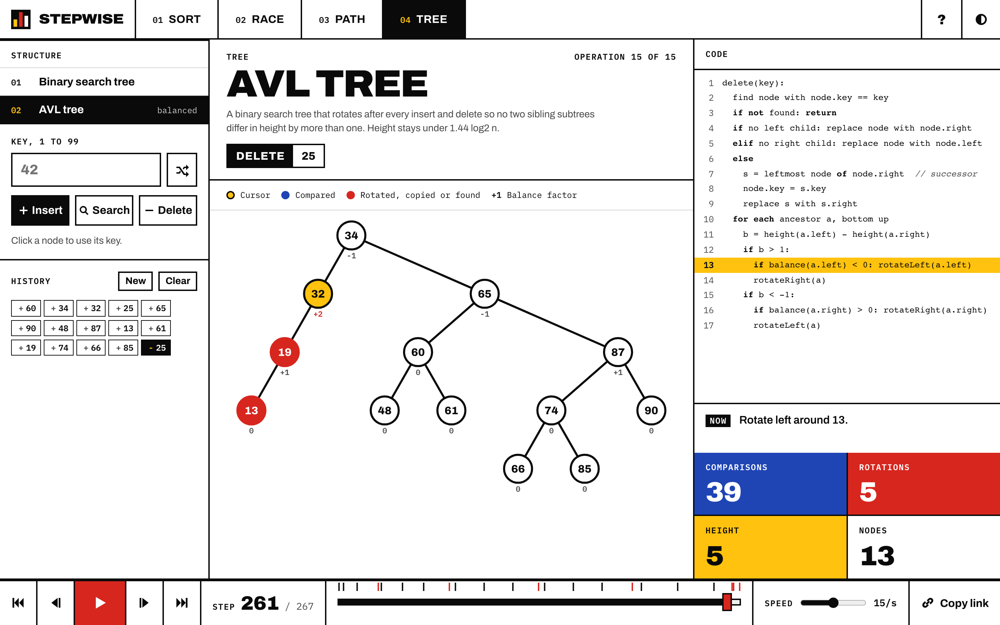
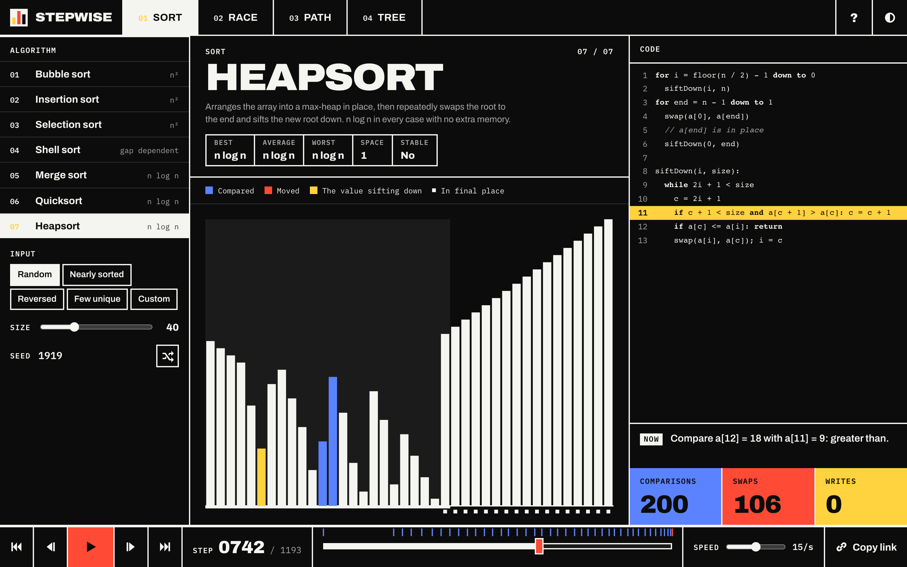

<picture>
  <source media="(prefers-color-scheme: dark)" srcset=".github/assets/banner-dark.svg">
  
</picture>

Stepwise lets you step, scrub and race through sorting, pathfinding and tree algorithms one event at a time, with the executing line highlighted and every moment shareable as a link.

[](https://github.com/emirk35/stepwise/actions/workflows/ci.yml)


**Live demo:** https://emirk35.github.io/stepwise/





## What it does

Most algorithm animations are videos: you watch them, but you cannot stop on the comparison that confused you, go back three steps, or send that exact moment to someone. Stepwise records the whole run first and then lets you move through it like a debugger.

Pick one of seven sorts, four graph searches or two tree structures. Shape the input (random, nearly sorted, reversed, few unique, or a list you type; walls, weights and endpoints painted on a grid; a history of inserts and deletes). Then play, pause, step one event either way, jump between markers, or drag the timeline. The code panel highlights the line that produced the current event, a caption says what happened in words, and counters keep score of comparisons, swaps, writes, visits and rotations. Race mode puts two sorts side by side on identical input and advances both by one operation per tick.

The address bar always describes what is on screen: algorithm, input, seed and step. Copy it, and the recipient lands on the same frame.

## Quick start

Requires Node 22.17 or newer (CI uses Node 26 LTS) and pnpm 9.

```sh
git clone https://github.com/emirk35/stepwise.git
cd stepwise
pnpm install
pnpm dev            # http://localhost:4310
```

```sh
pnpm test           # unit and property tests (Vitest + fast-check)
pnpm test:e2e       # builds, serves on 4312, runs the Playwright smoke test
pnpm lint && pnpm check
pnpm build          # static site in build/; BASE_PATH=/stepwise for GitHub Pages
pnpm bench          # timeline storage benchmark from docs/adr/0002
```

## Architecture



A page parses its query string into parameters, generates the input from a seed, and records the chosen algorithm into a `Timeline`. The `Player` owns only a step number and a clock. On every change the page asks the timeline for that frame, and the frame flows into a pure scene function and from there into SVG, while its `line` and `counts` drive the code panel and counters. When playback pauses, the page writes its parameters back to the URL.

Everything left of the Svelte page is plain TypeScript in `src/lib/engine`, `src/lib/algorithms`, `src/lib/render` and `src/lib/url`, with no framework imports. [docs/architecture.md](docs/architecture.md) lists every event type, the state shapes and sequence diagrams for recording, playback and opening a shared link.

## Deep dive: the tracing engine

### Algorithms are generators

Each algorithm is an ordinary generator function that yields typed events. Here is insertion sort's whole implementation:

```ts
*run(n) {
  for (let i = 1; i < n; i++) {
    yield { type: 'focus', lo: 0, hi: i, line: 1 };
    yield { type: 'mark', i, line: 2 };
    for (let j = i; j > 0; j--) {
      if ((yield { type: 'compare', i: j - 1, j, line: 3 }) <= 0) break;
      yield { type: 'swap', i: j - 1, j, line: 4 };
      yield { type: 'mark', i: j - 1, line: 5 };
    }
  }
}
```

Look at what is missing: the array. A sort receives only `n`. The value that comes back from `yield { type: 'compare', ... }` is the sign of `a[i] - a[j]`, computed by the sorting model against the recorder's copy of the data. Comparison sorts only ever learn about their input through comparisons, so this is not a restriction, and it buys something real: an algorithm cannot compare two values without the comparison being counted and shown, and it cannot move an element without the move appearing on screen. The counters are correct because there is no other path to the data.

Tree algorithms need to follow pointers, so they get a read-only view of the live tree, and the recorder applies each event before resuming the generator. They still change the tree only by yielding `attach`, `link`, `copy` or `rotate`.

### The recorder keeps a log, not a film

Keeping every frame makes seeking a lookup, but memory grows with events times state size, which is cubic in `n` for quadratic sorts. The timeline instead stores the event log and a full snapshot every 64 events:

```ts
seek(step: number): Frame<S, E, K> {
  const target = Number.isFinite(step) ? Math.max(0, Math.min(this.last, Math.trunc(step))) : 0;
  const nearest = Math.floor(target / this.interval);
  let cursor = this.#cursor;
  if (target < cursor.step || nearest * this.interval > cursor.step) {
    const checkpoint = this.#checkpoints[nearest];
    if (!checkpoint) throw new Error(`missing checkpoint ${nearest}`);
    cursor = copy(this.#model, checkpoint);
  }
  while (cursor.step < target) {
    advance(this.#model, cursor, this.events[cursor.step] as E);
  }
  this.#cursor = cursor;
  // ...returns a fresh clone of cursor.state with the event, line and counts
}
```

A random jump costs at most 63 event replays plus one clone. Playing forward reuses the cursor, so it costs one replay per step. Measured with `pnpm bench` on an Apple M2 Pro (Node 23.11): bubble sort on 128 reversed values records 16,765 events in 2.3 ms; keeping every frame would retain 17,983 KB, the checkpointed timeline retains 1,388 KB, and a random seek takes 2.5 microseconds. The full table, and why 64 rather than 16 or 256, is in [ADR 0002](docs/adr/0002-checkpoints-and-deltas.md).

Because frames are fresh copies, nothing that renders a frame can corrupt the recording, and backward stepping is exactly as cheap as forward.

### Rendering is a function of the frame

Each stage has a pure scene function: `barScene(frame, layout)`, `gridScene(frame, grid, size)`, `treeScene(frame, layout)`. It returns shapes with positions and tones, and the Svelte component only draws them:

```svelte
{#each scene.bars as bar (bar.id)}
	<g class="bar {bar.tone}" style:transform={`translate(${bar.x}px, ${bar.y}px)`}>
		<rect y={-bar.height} width={bar.width} height={bar.height} />
	</g>
{/each}
```

Bars are keyed by element identity, which the array model carries alongside values (and moves into the merge buffer and back), so a swap is two bars getting new transforms and a CSS transition does the rest. The duration follows the playback speed and drops to zero under `prefers-reduced-motion`. Highlights come from the frame's event alone: if the event is a `compare`, those two bars are blue. Nothing in the renderer remembers the previous frame, so scrubbing backward draws exactly what playing forward drew.

### Adding an algorithm is about 45 lines

Shell sort was added after the rest of the engine was finished. This is the entire change, 42 lines in one new file plus two in the registry:

```ts
import type { SortAlgorithm } from './algorithm.ts';

/** Ciura's empirically tuned gaps, largest first. */
const GAPS = [701, 301, 132, 57, 23, 10, 4, 1];

export const shell: SortAlgorithm = {
	id: 'shell',
	name: 'Shell sort',
	summary: "Insertion sort over shrinking gaps (Ciura's sequence), so values far from home ...",
	complexity: { best: 'n log n', average: 'gap dependent', worst: 'gap dependent', space: '1' },
	stable: false,
	markRole: 'the value being inserted',
	usesBuffer: false,
	code: [
		'for gap in [701, 301, 132, 57, 23, 10, 4, 1]',
		'  if gap >= n: continue',
		'  for i = gap to n - 1',
		'    j = i',
		'    while j >= gap and a[j - gap] > a[j]',
		'      swap(a[j - gap], a[j])',
		'      j = j - gap'
	],
	*run(n) {
		for (const gap of GAPS) {
			yield { type: 'line', line: 1 };
			if (gap >= n) {
				yield { type: 'line', line: 2 };
				continue;
			}
			for (let i = gap; i < n; i++) {
				yield { type: 'line', line: 3 };
				yield { type: 'mark', i, line: 4 };
				for (let j = i; j >= gap; j -= gap) {
					if ((yield { type: 'compare', i: j - gap, j, line: 5 }) <= 0) break;
					yield { type: 'swap', i: j - gap, j, line: 6 };
					yield { type: 'mark', i: j - gap, line: 7 };
				}
			}
		}
	}
};
```

```diff
 import { selection } from './selection.ts';
+import { shell } from './shell.ts';

 /** Display order in the picker. Adding an algorithm means adding it here. */
 export const SORTS: readonly SortAlgorithm[] = [
 	bubble,
 	insertion,
 	selection,
+	shell,
 	merge,
```

Nothing else changed: the picker, the code panel, the counters, race mode, the URL codec and the timeline markers all read from the registry. The property tests are parameterized over `SORTS`, so Shell sort was immediately checked for sorting arbitrary arrays, determinism, element conservation and listing bounds. That is the payoff of keeping algorithms, state, timeline and pixels apart: each new algorithm only has to describe what it does.

### Trees: every frame is a valid tree



The tree model works at the pointer level (`attach`, `link`, `rotate`), and every event leaves a valid binary tree, so any frame can be drawn on its own. That constraint picked the delete algorithm: a node with two children takes its successor's key (drawn as a dashed red arrow) and the successor is spliced out. Relinking the successor node into place instead would leave frames where it hangs from nothing. AVL rebalancing reuses the BST walks and then visits the changed path bottom-up, with balance factors drawn under each node so you can watch a +2 appear before the rotation fixes it.

The tree page keeps its whole history on one timeline, and the URL stores that history (`ops=i60,i34,...,d25`), so a link reproduces how the tree got its shape, not just the shape.

### The race clock counts operations

Race mode records both algorithms on the same input. One tick is one operation (a compare, swap or single-element write) in each lane; focus, mark and line events ride along for free, so a listing with more line markers is not slower. On 64 random values (seed 1919, the link in the screenshot above), Lomuto quicksort finishes in 510 operations and merge sort in 1,073.

## Design decisions

| Decision                                                               | Why                                                                 | ADR                                                |
| ---------------------------------------------------------------------- | ------------------------------------------------------------------- | -------------------------------------------------- |
| Generators yielding typed events, with replies                         | Counters cannot drift from code; each sort is 30 to 60 lines        | [0001](docs/adr/0001-algorithms-are-generators.md) |
| Event log plus a checkpoint every 64 events                            | 7 to 10 percent of the memory of storing frames, seeks under 5 us   | [0002](docs/adr/0002-checkpoints-and-deltas.md)    |
| SVG for every stage, no Canvas                                         | 60 fps with no dropped frames at 400 steps/s on the 1,215-cell grid | [0003](docs/adr/0003-svg-rendering.md)             |
| The URL is the state: seeds, literal lists, packed grids, op histories | Shareable without a server, round-trip tested                       | [0004](docs/adr/0004-url-is-the-state.md)          |
| Client-rendered static shells on GitHub Pages                          | No flash of default state on shared links                           | [0005](docs/adr/0005-static-client-rendered.md)    |

Quicksort uses Lomuto partitioning with the last element as pivot. Hoare's scheme does fewer swaps, but Lomuto's single scan is much easier to follow, and its weak spots are worth seeing: on sorted input it makes exactly n(n - 1)/2 comparisons, which a test asserts.

The visual language is Swiss and Bauhaus: a white ground, Archivo at weight 900 for display type, IBM Plex Mono for code and figures, a visible grid drawn with 2px rules, and red, blue and yellow used only as flat blocks with fixed meanings (blue compared, red moved, yellow held). There are no gradients or shadows, and motion decelerates without overshoot. The dark theme inverts the ground and ink and brightens the primaries; text on each primary was checked against WCAG AA (white on the red is 5.0:1, black on the yellow 12.2:1).



## Keyboard

`Space` plays and pauses, `←` and `→` step, `Shift` with an arrow jumps between markers (passes, merges, operations, rotations), `Home` and `End` jump to the ends, `1` to `9` set the speed from 1 to 400 steps per second, `R` makes a new random input, `T` toggles the theme and `?` shows the cheatsheet. When the path grid has focus, the arrows move a cell cursor, `Enter` paints and `S` or `G` place the start or goal. Shortcuts stay out of the way of focused controls that need the same keys.

## Testing

```sh
pnpm test        # 121 tests in 9 files
pnpm test:e2e    # 5 Playwright tests against the production build
```

Most of the suite is property-based with fast-check. For every sort, arbitrary integer arrays (including heavily duplicated ones) must end sorted, record identical events twice, replay to the same frame at every step, never lose or duplicate an element mid-run, and, for stable sorts, keep equal values in order. Bubble and insertion sort must swap exactly once per inversion; selection sort must compare exactly n(n - 1)/2 times. On random grids up to 9 x 9, Dijkstra's path cost must match a brute-force relaxation reference, A* must match it under every admissible heuristic, BFS must find the fewest moves, and every returned path is walked and re-costed. Random insert, search and delete sequences must leave the tree equal to a reference set after every operation, with AVL balance factors within one. The URL codecs round-trip arbitrary valid states. A deliberately inadmissible heuristic has an example test showing it returning a costlier path, so the A* property is not vacuous.

The Playwright smoke test opens a shared sort link and checks the step counter, the highlighted line and the swap counter against what the engine itself computes for that frame, then steps with the keyboard and checks that the URL follows.

## Project structure

```
src/
  lib/
    engine/          trace types, record(), Timeline, seeded PRNG
    algorithms/
      sorting/       array model, 7 sorts, inputs
      pathfinding/   grid, search model, BFS, DFS, Dijkstra, A*, heuristics
      trees/         pointer model, BST walks, AVL rebalancing
    render/          pure scene functions, captions, markers, tweening
    url/             query codecs and address-bar sync
    components/      Svelte stages, transport, code panel, controls
    player.svelte.ts playback clock
  routes/            /, /sort, /race, /path, /tree, error page
scripts/bench-timeline.ts
tests/e2e/smoke.spec.ts
docs/architecture.md, docs/adr/
```

## Roadmap

- A Canvas tile layer for grids larger than 45 x 27; the grid scene already yields a flat tone array that maps onto a fill loop.
- Diagonal moves with an octile heuristic, which would also make the Chebyshev heuristic tight.
- Hoare partitioning as a second quicksort, so race mode can put the two schemes head to head.
- A heap view for heapsort that draws the implicit binary heap above the bars.

## License

[MIT](LICENSE)
