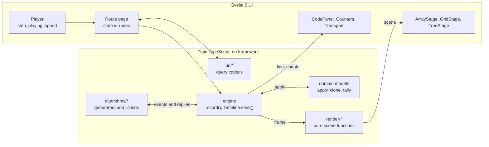
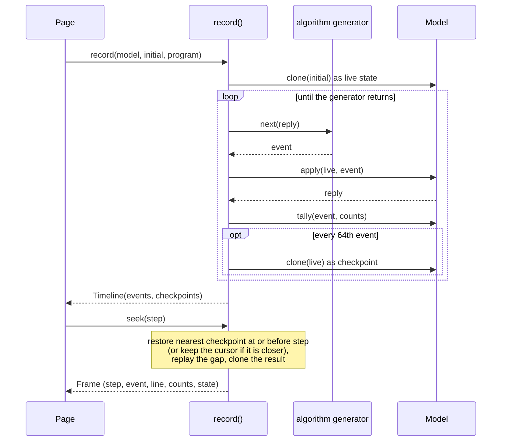
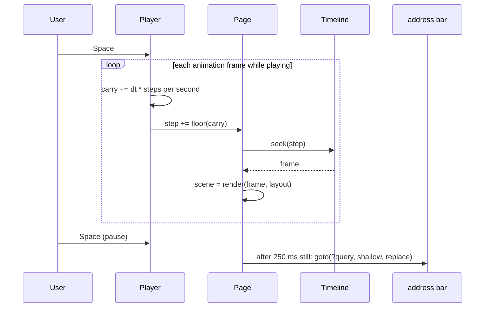
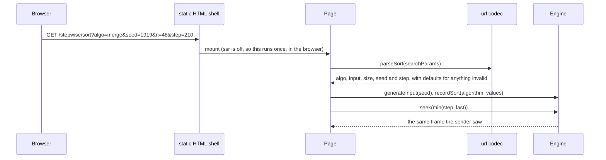

# Architecture

Stepwise is a static SvelteKit app over a small, framework-agnostic core. Everything under `src/lib/engine`, `src/lib/algorithms`, `src/lib/render` and `src/lib/url` is plain TypeScript with no Svelte imports; it runs under Node for tests and benchmarks exactly as it runs in the browser.

## Layers



| Module                   | Responsibility                                                                                                               |
| ------------------------ | ---------------------------------------------------------------------------------------------------------------------------- |
| `engine/trace.ts`        | `TraceEvent`, `Model`, `Frame`, `Program` types.                                                                             |
| `engine/timeline.ts`     | `record()` runs a program against a private state and keeps the log plus checkpoints; `Timeline.seek()` materializes frames. |
| `engine/random.ts`       | Seeded mulberry32, `shuffle`, `integer`, fresh seeds.                                                                        |
| `algorithms/sorting`     | Array model, seven sorts, input generators and the custom-list parser.                                                       |
| `algorithms/pathfinding` | Grid type and codec, seeded layouts, search model, BFS, DFS, Dijkstra, A* and heuristics.                                    |
| `algorithms/trees`       | Pointer-level tree model, BST walks, AVL rebalancing.                                                                        |
| `render/*`               | `barScene`, `gridScene`, `treeScene`, captions, timeline markers, tweening. All pure.                                        |
| `url/*`                  | Parse and format each page's query string; `sync.svelte.ts` writes it back.                                                  |
| `player.svelte.ts`       | Playback clock on `requestAnimationFrame` with a fractional carry.                                                           |
| `keyboard.ts`            | Decides when a global shortcut may take a key from a focused control.                                                        |

## Data model

An event is a plain object with a `type`, the listing `line` it belongs to, and domain fields. A domain is a `Model<State, Event, Counter, Reply>`:

```ts
interface Model<S, E extends TraceEvent, K extends string, R = void> {
	readonly counters: readonly K[];
	clone(state: S): S;
	apply(state: S, event: E): R; // mutates; returns the reply for the generator
	tally(event: E, counts: Record<K, number>): void;
}
```

### Sorting (`ArrayState`)

State is typed arrays: `values`, `ids` (stable element identity for animation, `-1` while the element is in the buffer), `buffer`, `bufferIds`, `sorted` flags, plus `mark` and the `focus` range.

| Event     | Fields          | Effect                                            | Counter     |
| --------- | --------------- | ------------------------------------------------- | ----------- |
| `compare` | `i, j, buffer?` | none; replies `sign(a[i] - a[j])`                 | comparisons |
| `swap`    | `i, j`          | exchanges values and ids                          | swaps       |
| `copy`    | `i`             | moves `a[i]` into buffer slot `i`                 | writes      |
| `write`   | `i, from`       | moves buffer slot `from` into `a[i]`              | writes      |
| `mark`    | `i`             | highlights the held element (pivot, minimum, key) |             |
| `sorted`  | `lo, hi`        | flags final positions                             |             |
| `focus`   | `lo, hi`        | active subarray                                   |             |
| `done`    |                 | appended by `recordSort`; everything final        |             |
| `line`    |                 | moves the code cursor only                        |             |

### Pathfinding (`SearchState`)

Per cell: `status` (unseen, frontier, visited), best `cost`, `parent`. Plus the path revealed so far, the current cell, a frontier count and the outcome. The grid itself is immutable input and is not part of the state, which keeps checkpoints small.

| Event     | Fields             | Effect                                                | Counter |
| --------- | ------------------ | ----------------------------------------------------- | ------- |
| `enqueue` | `cell, from, cost` | BFS and DFS: cell joins the frontier                  | pushes  |
| `relax`   | `cell, from, cost` | Dijkstra and A*: cheaper route found, cell (re)pushed | pushes  |
| `visit`   | `cell`             | cell leaves the frontier and is expanded              | visited |
| `path`    | `cell`             | one cell of the answer, goal first                    |         |
| `done`    | `found, cost`      | outcome and weighted path cost                        |         |

### Trees (`TreeState`)

Nodes are indices into parallel `key`, `left` and `right` arrays; `-1` is "no node". Deleted nodes are simply unreachable from `root`. The state also tracks the current operation, a cursor, the node the operation's key was last compared with (`probe`), and the result.

| Event     | Fields                    | Effect                                               | Counter     |
| --------- | ------------------------- | ---------------------------------------------------- | ----------- |
| `begin`   | `op`                      | starts an operation; the code panel switches listing |             |
| `visit`   | `node`                    | moves the cursor                                     |             |
| `compare` | `node`                    | replies `sign(op.key - key[node])`                   | comparisons |
| `attach`  | `node, key, parent, side` | creates a node and hangs it in place                 |             |
| `link`    | `parent, side, child`     | rewires one pointer (or the root)                    |             |
| `copy`    | `from, to`                | successor key into the node being deleted            |             |
| `rotate`  | `node, dir, parent, side` | single rotation, relinked into its parent            | rotations   |
| `result`  | `node, outcome`           | inserted, duplicate, found, missing or deleted       |             |

Every tree event leaves a valid binary tree behind. That is why a two-child delete copies the successor's key and splices the successor out, instead of relinking the successor node into place: the relinking version has intermediate frames where the successor is attached nowhere.

## Recording and seeking



The recorder caps a run at 250,000 events and marks the timeline `truncated`; with the UI's limits the largest run is 16,765 events (bubble sort on 128 reversed values).

## Playback and the address bar



At 400 steps per second and 60 frames per second the player moves 6 or 7 steps per frame; the carry keeps the average exact. Moves animate for 85 percent of a step, capped at 220 ms, and not at all when steps are shorter than 20 ms or the user prefers reduced motion.

## Opening a shared link



## The race clock

Race mode runs two timelines over one input. One tick is one operation (`compare`, `swap`, `copy` or `write`) in each lane; bookkeeping events (`focus`, `mark`, `line`) ride along for free, so a listing with more line markers is not penalized. Each lane precomputes the frame index of its n-th operation, and tick `t` shows frame `operations[t - 1]`, or the final frame once `t` passes the lane's total.

## Invariants the tests pin down

| Invariant                                                                                                     | Where                       |
| ------------------------------------------------------------------------------------------------------------- | --------------------------- |
| Every sort's final frame equals the input sorted numerically, for arbitrary integer arrays                    | `sorting.test.ts`           |
| Recording twice gives identical events; replaying from frame 0 reproduces every frame                         | sorting, pathfinding, trees |
| Every element lives in exactly one array or buffer slot at every frame                                        | `sorting.test.ts`           |
| Stable sorts keep equal values in original order (checked through element ids)                                | `sorting.test.ts`           |
| Bubble and insertion sort swap exactly once per inversion                                                     | `sorting.test.ts`           |
| Dijkstra's cost equals a brute-force relaxation reference; A* matches it with each admissible heuristic       | `pathfinding.test.ts`       |
| BFS finds the fewest moves; DFS finds a valid path exactly when one exists                                    | `pathfinding.test.ts`       |
| The frontier counter equals the number of frontier cells at every sampled frame                               | `pathfinding.test.ts`       |
| After every operation the tree's in-order keys equal a reference set, and AVL balance factors stay within one | `trees.test.ts`             |
| `seek(i)` equals stepwise replay for random seek sequences and checkpoint intervals                           | `timeline.test.ts`          |
| Every page state survives format then parse                                                                   | `url.test.ts`               |
